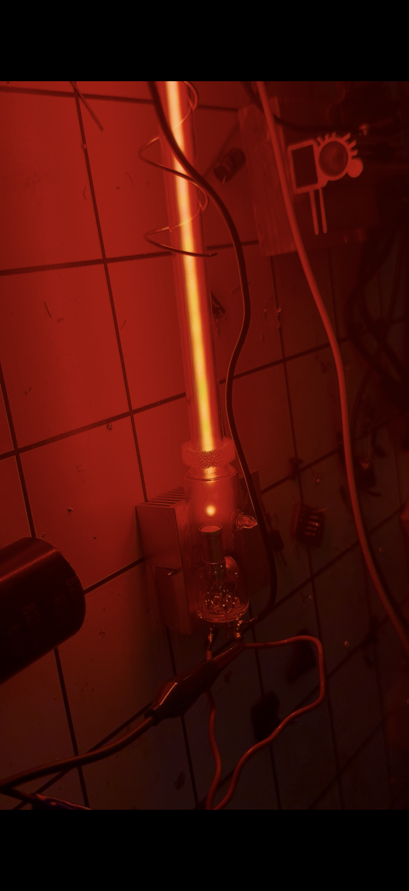
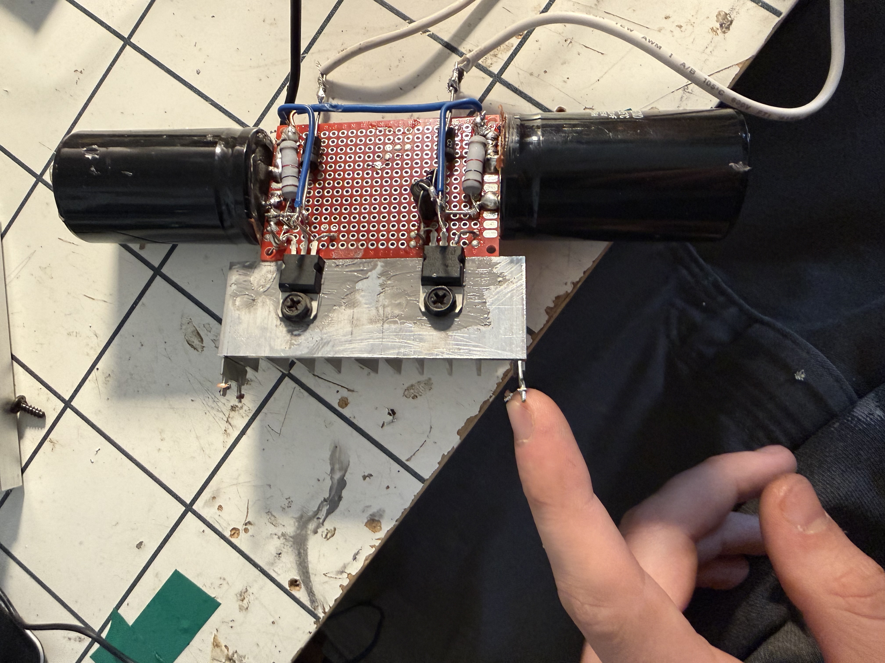
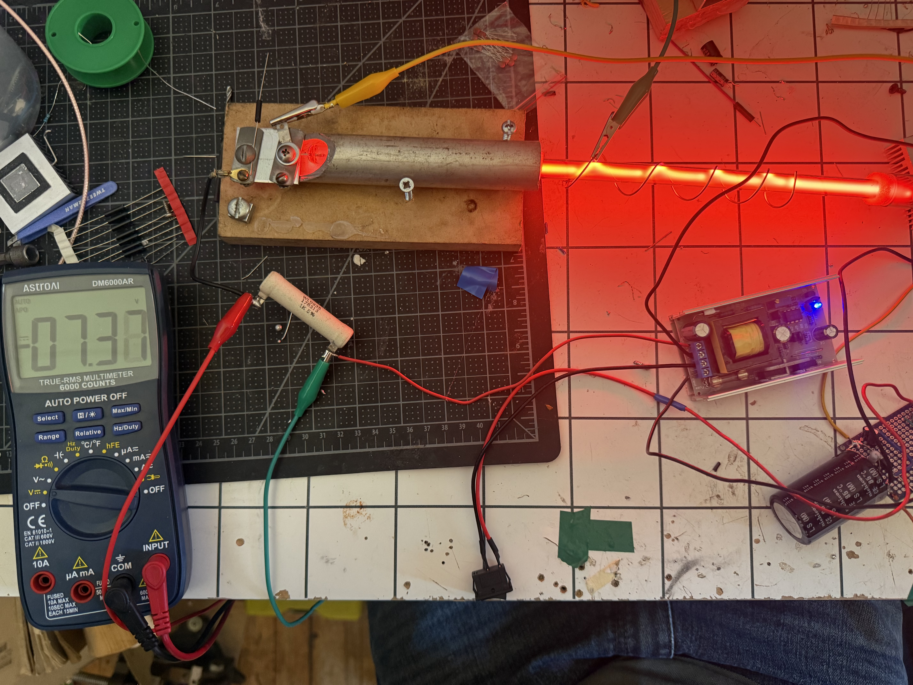
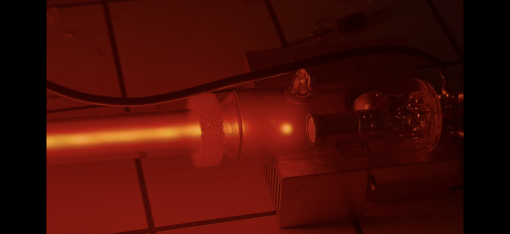

# Abstract
The GSH-1 is a 1970s era hot cathode neon fill vacuum tube the soviets manufactured for radar calibration. This is the second and final iteration of this project, my goal is to measure and identify the electric noise spectrum, which is broadband in nature and produced by a combination of shot-noise, thermal, and gas ionization factors. 
# Schematic 
.jpg)

# Build Log 

**Day 1 10/15**

The main issue in the circuit topology of the Plasma Entropy Source V.1 was the anode; where 200Vdc , 10kvac and the decoupling capacitors all met. The 200Vdc took the path of less impedance and traveled through the 10kv strike line instead of through the tube. 
To combat this issue, I decided to redesign the power supply essentially. Instead of these three components meeting at one node, I removed the 10kv strike voltage and opted for ionization by induction instead. 
I put the tube inside of an aluminum spring and connected one end of the 10kv supply output to it. 
I got the positive column fully extended but the tube won't sustain on solely DC yet. 

**Day 2 10/17**

I started working on the power supply. It's imperative to this project I minimize electrical noise, so I'm avoiding switching power supply's and am instead using a transformer I found in an old radio receiver. I need two or three 12Vdc and one 6vdc. In order to filter mains ripples out, I put one 7500uf or 8500uf capacitor per output of halfwave rectifier. As predicted the ripples are 120hz post rectification. For whatever reason I noticed some higher frequency noise as well on my oscilloscope , the VPP in the mV so noise of relatively low amplitude. I added linear regulators (L78012) and .1uF and 100uF on the ouput , now the noise is no more.

**Day 3 10/19**

I finally got the GSH-1 tube to sustain on DC! 
This how the day went; at first, I couldn't figure out exactly why it wasn't working and why I was only getting 3 V across my 1k ballast (that's 3mA). For whatever reason there was practically no current passing through the tube. When I turned up the RF 10kv module, the DC passing through increased exponentially, I figured this was because of charge carriers being added to the mix and the plasma becoming more excited therefore becoming more conductive. It was still far lower than I needed, however. 
I decided to do some casual research and noticed an obvious flaw all of a sudden. On the cathode side, I didn't tie one of the filament electrodes to the same ground plane as the 0v coming from the DC boost module. They had to be tied in order for the electrons to properly flow from the cathode. I tied the two pins together; however, the tube still wouldn't sustain. At this point I knew I was missing something because this was defying logic. The only thing I noticed was that now across my 1kv ballast I was reading 7mA! A serious increase from 3mA.

I started troubleshooting; I'd turn the strike voltage input down as much as I could from my lab supply until the ionization would go out, I started at 12vin and went down to 5v at which the RF 10kv strike voltage module would go out. I noticed, with the decreasing RF, I could more easily see the effects of the DC boost module. At this time, I had turned up the output voltage to 300Vdc, so the tube's emissions were especially bright. Because I was only feeding 5V to the RF 10kv module the ionization was mostly caused by the 300vdc yet still needed the 10kv strike on at all times to sustain. I noticed there was a strange oscillation happening - the tube was blinking very quickly, the same HZ at which an LED on the DC boost was flicker. From this data I deduced that the supply was starved for current, I was right - across the input I read 9V, it needed anywhere from 12-24v. 
I fed it 20v and the tube finally sustained. What a beautiful and satisfying feeling it was seeing the tube glow truly as intended for the first time.
The GSH-1 sustains at 293Vdc, 87 mA. No less then 290vdc will the tube sustain. Although it's rated for 250v, I assume because it's from the 1970s, the pressure has changed or maybe even helium atoms have penetrated the glass envelope overtime. These factors causing the required voltage to rise. 
A favorite feature of mine in the tube's emission is this little congregation of plasma on the cathode! It's what I believe is the cathode dark zone, either way super cool to see. 

**Day 4 10/20** 

With the tube finally sustaining I know had to see what the noise spectrum looked like, unfortunately all I have in terms of measurement methodology is a cheap handheld oscilloscope which doesn't even have a frequency analyzer, but it'll do for now. I connected to the anode of the tube and grounded the scope and notice a variety of electrical noise 10khz all the way up to 300khz. I assume this is from the HV boost converter, and I was reading switching noise. I designed an LC circuit at the output of the DC boost converter. It's a low pass filter, with a cut off frequency of 610hz. I put a 68uF 500v rated cap in series with a 10mH inductor and read 2-6khz at the output being relatively steady. Seeing the semi steady frequency noise on the output was satisfying, I sucessfully removed higher frequency noise, although I need to mitigate the noise further. 

**Day 5 10/25** 
 
I designed several filters to try and filter out the 3khz noise. Although I successfully filtered out the high ends, something was amiss, the math wasn't 'mathing'. My first LC filter I designed (Day 4) wasn't filtering out 2-6khz noise despite the cutoff being set at 610hz. I decided to design several more filters and test each one. I designed 4 total including the original. The last one worked the best; which was the 68uF cap going to ground, 10mH inductor in series, 10,000pF cap going to ground, 1k 25-watt ballast, 10,000 pF to ground, and only then connected to the anode of the tube. This is essentially and LC and RC filter in series, despite the non-conventionality it worked very well. So well, I grew suspicious. I was reading an extremely stable 3.02khz signal on the anode in a warped saw-toothed waveform. It was so stable I first assumed it was a relaxation oscillation, set by the 1k ballast and 10,000pF capacitor, however the time constant was equal to 15khz, not 3khz. So, I knew it wasn't that. My current 
I had an epiphany at work, 
